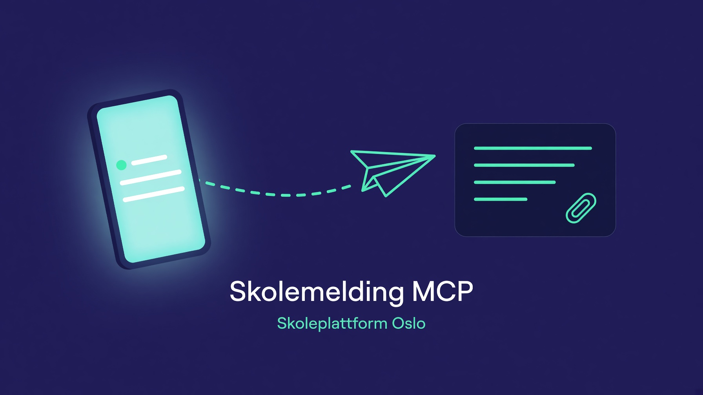
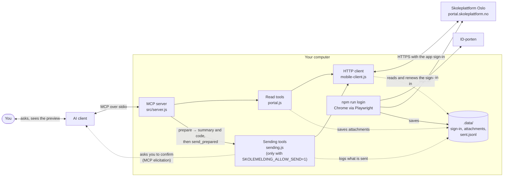

<p align="center"></p>

<h1 align="center">Skolemelding MCP</h1>

<p align="center">
  <a href="https://github.com/kristoffervp/skolemelding-mcp/actions/workflows/test.yml"></a>
  <a href="https://github.com/kristoffervp/skolemelding-mcp/releases"></a>
  <a href="LICENSE"></a>
</p>

<p align="center">English · <a href="README.no.md">Norsk</a></p>

A local MCP server that lets an AI client read your Skoleplattform Oslo (Skolemelding) messages and attachments. It can also send replies, answers and absence reports, but only if you turn that on.

**Unofficial.** Not made by or affiliated with Oslo kommune or the makers of Skoleplattform. It uses undocumented endpoints that can change without notice.

## Quick start

You need Node.js 20 or later and Google Chrome.

```sh
git clone https://github.com/kristoffervp/skolemelding-mcp.git
cd skolemelding-mcp
npm install
npm run login
```

`npm run login` opens Chrome for the ID-porten sign-in, and `npm test` checks the server without using your account. Then add the server to your AI client as a local (stdio) server. For Claude Desktop, in `claude_desktop_config.json`:

```json
{
  "mcpServers": {
    "skolemelding": {
      "command": "node",
      "args": ["/full/path/to/skolemelding-mcp/src/server.js"]
    }
  }
}
```

## Tools

| Tool | What it does |
| --- | --- |
| `list_children` | Your children and their schools |
| `list_messages` | Up to 100 received messages, newest first, with a preview. Filters: `search`, `child`, `unread_only`, `questions_only`, `absence_only` |
| `get_message` | One message and its replies as plain text (`include_html` adds the HTML). Finds older messages by ID by scanning up to 1,500 inbox entries |
| `get_attachment` | Saves an attachment in `.data/attachments/` and returns the path (`include_content` also returns the file) |

Reading never marks a message as read. A message has `question` when the school asks a yes/no question, and `readConfirmationRequested` when it asks you to confirm that you have read it. Each message lists the children it is about. Results are returned as `structuredContent` described by an `outputSchema`, and as JSON text.

Clients that can't read local files, such as Claude Desktop and the ChatGPT app, need `include_content: true` to see an attachment. Unusual file types are saved with `.download` added, and on macOS and Windows saved files are marked as downloaded, so the system warns before opening them.

So far this has only been tested on an account with one child. See [issue #10](https://github.com/kristoffervp/skolemelding-mcp/issues/10) if you can test with more.

## Sending (opt-in)

Set `SKOLEMELDING_ALLOW_SEND=1` (in `"env"` in the client config) to add these tools:

| Tool | What it does |
| --- | --- |
| `list_recipients` | Lists the staff you can write to about a child, the child's own teachers first |
| `prepare_reply` | Prepares a reply to a message, in its thread, or as a new thread to the sender |
| `prepare_answer` | Prepares `ja` or `nei` to a yes/no question |
| `prepare_read_confirmation` | Prepares a confirmation that you have read a message |
| `prepare_message` | Prepares a new message to at most 5 staff from `list_recipients` |
| `prepare_absence` | Prepares an absence report («Melding om fravær»): `today`, `tomorrow`, or dates (`YYYY-MM-DD`) with optional times (`HH:MM`) |
| `send_prepared` | Sends what a prepare tool prepared |
| `mark_read` | Marks a message and its unread replies as read, in one step. It can't be marked unread again |

Every send takes two steps. A prepare tool checks the request and returns exactly what would be sent, with a one-time code. Nothing has been sent at that point. `send_prepared` sends it once, and the code expires after 10 minutes. `send_prepared` must also repeat the one-line `summary` from the prepare step, so your client's approval prompt shows what is sent. Everything sent is logged in `.data/sent.jsonl`.

The server can't know that you approved, so:
- If your client supports MCP elicitation (Claude Code does), the server asks you itself before `send_prepared` and `mark_read` go through. The AI can't answer that question for you.
- Otherwise your client's own approval prompt is the only check. Never choose «Always allow» for `send_prepared` or `mark_read`.
- Prepared codes belong to the running server, so a code from one chat works in another chat in the same client for 10 minutes.

- `include_other_parents` sends a copy to the child's other parents, like «Kopi til» in the app. For replies, Skolemelding only allows it when the reply starts a new thread.
- Text only. Attachments and images are not supported.
- After an answer or read confirmation, the server reads the message again and reports `verified`.
- A message can contain text meant to make the AI client send something. Read the preview, and leave sending off when you don't need it.

## How it works

The server runs on your computer and talks to the AI client over stdio. Reading and sending both use the sign-in from `npm run login`, saved in `.data/`.



## Configuration

Set these in the client config (and in Terminal for `npm run login`):

| Variable | Default | Purpose |
| --- | --- | --- |
| `SKOLEMELDING_ALLOW_SEND` | off | `1` adds the sending tools |
| `SKOLEMELDING_DATA_DIR` | `.data` in this folder | Sign-in, attachments and the log of sent items |
| `SKOLEMELDING_MOBILE_AUTH_FILE` | `mobile-auth.json` in the data folder | The saved sign-in |
| `SKOLEMELDING_ATTACHMENT_DIR` | `attachments` in the data folder | Where attachments are saved |
| `SKOLEMELDING_BROWSER_CHANNEL` | `chrome` (`msedge` on Windows) | Browser for the sign-in |
| `SKOLEMELDING_PLAYWRIGHT_PATH` | `playwright` in `node_modules` | Playwright installation |
| `SKOLEMELDING_APP_VERSION` | `6.0.6` | App version sent to Skolemelding |
| `SKOLEMELDING_OIDC_CLIENT_ID`, `SKOLEMELDING_TOKEN_CLIENT_ID` | From the official app | Sign-in client IDs |

## Troubleshooting

- **"Not signed in" or "sign-in has expired".** Run `npm run login` again.
- **Sign-in or refresh is rejected after an app update.** The sign-in imitates the Skolemelding Foresatte app. Set `SKOLEMELDING_APP_VERSION` to the version in the app store, then run `npm run login`.
- **The client can't start the server.** Use full paths for both `node` (from `command -v node`) and `src/server.js`.
- **An attachment is refused.** The school may have removed it.
- **`unread` is out of date.** Messages are cached for five minutes.

## Security and privacy

- The server runs on your computer and opens no network port. Any AI client you connect can still read your school messages, and a cloud AI service receives what the client reads. Decide what you are willing to share.
- Message text is passed on as information, not instructions. Invisible characters and hidden HTML are removed, but that can't stop every attempt to steer the AI. Use clients you trust and review tool calls.
- Error messages shown to the client are written by the server itself and never repeat responses from Skolemelding or the content of local files.
- `.data/` holds your sign-in. Never share it. Attachments stay there until you delete them, and the paths returned to the client include your user name.
- Signing in registers this computer as a device on your account, as the app does. It sends the operating system and its version, the app version and a random device ID. The browser profile used for the sign-in is deleted afterwards.
- To report a vulnerability, see [SECURITY.md](SECURITY.md).

## Changelog

See [CHANGELOG.md](CHANGELOG.md) and [Releases](https://github.com/kristoffervp/skolemelding-mcp/releases).

## License

[0BSD](LICENSE): use, change and share it freely, also commercially, without attribution. It does not cover the Skolemelding service or its data.
