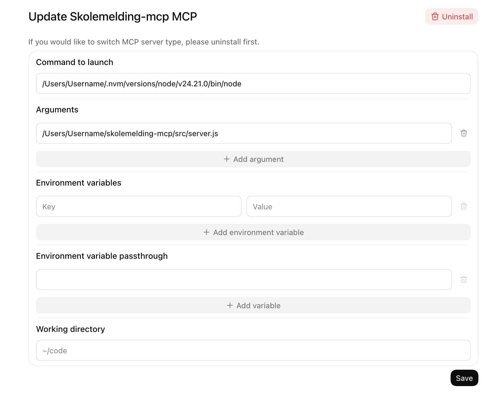

# Skolemelding MCP

English · [Norsk](README.no.md)

Read Skoleplattform Oslo messages and attachments through a local MCP server. Its four tools list your children, list messages, read a message, and download an attachment. They do not send replies or mark messages as read.

This is a simple local version that runs on your own computer. `list_messages` shows at most 100 messages. It can search for words in the messages and list only unread messages, messages with a yes/no question, or absence messages; there is no date-range search yet. If you know a message ID, `get_message` can also find older messages by scanning up to 1,500 inbox entries. There is no fixed date cutoff in this code, but how far back it can reach depends on the Skolemelding service and how many newer messages you have.

When the school asks for a yes/no answer, the message includes `question` with the question text. When it asks parents to confirm that they have read it, the message includes `readConfirmationRequested`. The MCP cannot answer either one; use the Skolemelding app for that.

Each message lists the children it is about. If you have more than one child at an Oslo school, `list_children` shows their names, and `list_messages` takes a `child` (first name or full name) to list only that child's messages. This has only been tested on an account with one child; see [issue #10](https://github.com/kristoffervp/skolemelding-mcp/issues/10) if you can help test it with several.

At some Oslo schools, email notifications no longer include message contents or attachments. This MCP makes it easier to retrieve them from Skolemelding and use them in an agent workflow. You are responsible for deciding whether to share school information with ChatGPT or other cloud-based or commercial AI services.

## Example: put a school event on a calendar

An email notification titled “Ny Skolemelding” says a new school message is available, but does not include its contents. An assistant can use this MCP to find and read the message, then download any attachments that contain event details (with `include_content: true` if the client cannot read local files).

For example, a message says there will be a maths assessment on Tuesday morning and asks pupils to eat breakfast and arrive on time. The assistant can add an all-day calendar event for Tuesday with those instructions in the description. It should not invent a start time, and it should check for an existing event before creating one. If the Skolemelding session has expired, the assistant can ask the user to refresh it with `npm run login` and retry afterward.

## Install

Install Node.js 20 or later and Google Chrome. In Terminal, open this project folder and run:

```sh
npm install
npm run login
```

Complete the ID-porten sign-in in Chrome. Run `npm test` to check the server without using your account.

## Add to the ChatGPT desktop app (example)

Open **Settings → MCP servers → Add server** and choose **STDIO**. Enter:

| Field | Value |
| --- | --- |
| Command to launch | Absolute path to Node.js; find it with `command -v node` |
| Arguments | One argument: absolute path to this project's `src/server.js` |
| Working directory | Absolute path to this project folder |
| Environment variables | Leave empty |

Save, restart ChatGPT, then type `/mcp` in a chat to check the connection. Replace the example paths in the screenshot with your own. The pictured `~/code` is only a placeholder for the working directory.



This screenshot shows just one setup example. The server can also work with [Claude Desktop](https://support.claude.com/en/articles/10949351-getting-started-with-local-mcp-servers-on-claude-desktop), [Grok Build](https://docs.x.ai/build/features/mcp-servers), or a client using a local AI model if that client supports local stdio MCP servers. Follow each client's setup instructions; a model alone cannot connect to MCP. ChatGPT in a web browser does not use this local setup.

## Attachments and configuration

`get_attachment` saves the file in `.data/attachments/` and returns its path, name, type, and size. The tool result only contains the file itself when the tool is called with `include_content: true`; images are then returned as images and other files as embedded resources. Clients that cannot read local files, such as the ChatGPT desktop app or Claude Desktop, need `include_content: true` to see what an attachment says. Clients that can read local files can open the saved file without it.

Files that are not common documents, images, audio, video or ZIP archives are saved with `.download` added to the name, so they are not opened or run by mistake. On macOS and Windows, saved attachments are also marked as downloaded from the internet, so the system warns before opening them.

`get_message` returns the message and its replies as plain text; add `include_html: true` to also get the original HTML. Messages are reused for up to five minutes, so `unread` can lag behind after you read a message in the app.

Version 0.3.0 changed these defaults. Earlier versions always returned attachments as `base64` and messages with `bodyHtml`.

To change the defaults, set these environment variables in the MCP client settings (and in Terminal for `npm run login`):

| Variable | Default | Purpose |
| --- | --- | --- |
| `SKOLEMELDING_DATA_DIR` | `.data` in this project | Sign-in file and saved attachments |
| `SKOLEMELDING_MOBILE_AUTH_FILE` | `mobile-auth.json` in the data folder | Saved sign-in |
| `SKOLEMELDING_ATTACHMENT_DIR` | `attachments` in the data folder | Where `get_attachment` saves files |
| `SKOLEMELDING_BROWSER_CHANNEL` | `chrome` (`msedge` on Windows) | Browser used for sign-in |
| `SKOLEMELDING_PLAYWRIGHT_PATH` | `playwright` from `node_modules` | Playwright installation to use |
| `SKOLEMELDING_APP_VERSION` | `6.0.6` | App version sent to Skolemelding |
| `SKOLEMELDING_OIDC_CLIENT_ID`, `SKOLEMELDING_TOKEN_CLIENT_ID` | Values from the official app | Sign-in client IDs |

The sign-in imitates the official Skolemelding Foresatte app. If Skolemelding starts rejecting sign-ins or refreshes after an app update, set `SKOLEMELDING_APP_VERSION` to the version in the current app store listing and run `npm run login` again.

## Security and privacy

This MCP runs locally and does not open a network port. An AI client you connect can still retrieve school messages and attachments from your account. Content used with a cloud AI service may be sent to that service. Messages may also contain text intended to influence the agent. The MCP removes invisible characters and text hidden in the message HTML, and its tool descriptions tell the client to treat message text as information, not instructions, but this cannot stop every attempt. Use clients you trust, review tool calls, and never share the sign-in files in `.data/`. Saved attachments stay in the attachment folder until you delete them.

Signing in registers this computer as a device on your Skolemelding account, the same way the mobile app does. It sends the operating system name and kernel version (for example `darwin|25.6.0`), the app version, and a random device ID created at sign-in.

`npm run login` uses a new, empty browser profile and deletes it when sign-in is finished, so no ID-porten session or saved password is left behind. Versions before 0.5.1 kept a browser profile in `.data/mobile-browser-profile/`; you can delete that folder.

The integration uses undocumented Skolemelding endpoints that may change. If your session expires, run `npm run login` again.

## Changelog

### 0.5.1
- `npm run login` no longer keeps a browser profile; `SKOLEMELDING_MOBILE_PROFILE` is removed. You can delete an old `.data/mobile-browser-profile/` folder.
- Invisible characters and hidden text are removed from message text, and the tool descriptions say message text is information, not instructions.
- Attachments of unusual types are saved with `.download` added, and saved attachments are marked as downloaded on macOS and Windows.
- Messages no longer include `recipients`.
- Only one inbox scan runs at a time, and a scan stops after 90 seconds. Error messages no longer show local file paths.

### 0.5.0
- `list_messages` takes `search`, `unread_only`, `questions_only` and `absence_only`. Skolemelding does the searching and filtering.
- Messages show the school's yes/no question (`question`) and whether it asks parents to confirm they have read the message (`readConfirmationRequested`).

### 0.4.0 (2026-11-09)
- New `list_children` tool, plus a `child` filter on `list_messages`.
- Each message shows which children it is about.
- `recipients` is left out when it is empty.

### 0.3.0 (2026-11-09)
- `get_attachment` saves the file locally and returns its path. The file itself is only returned with `include_content: true`.
- `get_message` returns plain text, also for replies. The HTML is only returned with `include_html: true`.
- The server handles several requests at once, and messages are cached for five minutes.
- The app version and client IDs can be set with environment variables.
- Tests run automatically on GitHub for every change.

### 0.2.0 (2026-10-06)
- First public version: `list_messages`, `get_message` and `get_attachment`.

## License

The code and documentation use the [0BSD license](LICENSE): free for anyone to use, change, and share for any purpose, including commercial use, without attribution. The license does not cover the Skolemelding service or its data.

To publish, use Git and check `git status --short` before committing. `.gitignore` excludes local sign-ins, research files, installed packages, and ZIP archives. Do not upload the whole folder manually.
