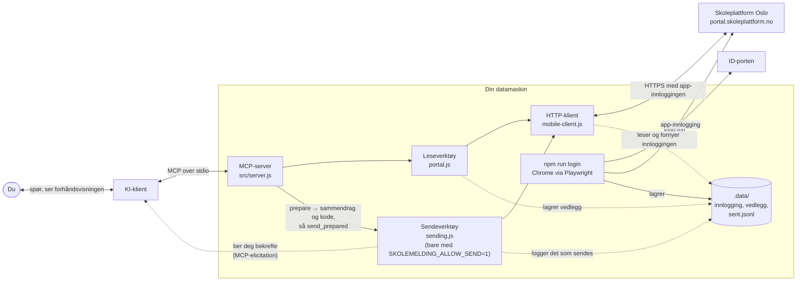

<p align="center"></p>

<h1 align="center">Skolemelding MCP</h1>

<p align="center">
  <a href="https://github.com/kristoffervp/skolemelding-mcp/actions/workflows/test.yml"></a>
  <a href="https://github.com/kristoffervp/skolemelding-mcp/releases"></a>
  <a href="LICENSE"></a>
</p>

<p align="center">Norsk · <a href="README.md">English</a></p>

En lokal MCP-server som lar en KI-klient lese meldingene og vedleggene dine i Skoleplattform Oslo (Skolemelding). Den kan også sende svar, ja/nei-svar og fraværsmeldinger, men bare hvis du slår det på.

**Uoffisiell.** Ikke laget av eller knyttet til Oslo kommune eller dem som lager Skoleplattform. Den bruker udokumenterte endepunkter som kan endres uten varsel.

## Kom i gang

Du trenger Node.js 20 eller nyere og Google Chrome.

```sh
git clone https://github.com/kristoffervp/skolemelding-mcp.git
cd skolemelding-mcp
npm install
npm run login
```

`npm run login` åpner Chrome for innlogging med ID-porten, og `npm test` sjekker serveren uten å bruke kontoen din. Legg så til serveren i KI-klienten som en lokal (stdio) server. For Claude Desktop, i `claude_desktop_config.json`:

```json
{
  "mcpServers": {
    "skolemelding": {
      "command": "node",
      "args": ["/full/sti/til/skolemelding-mcp/src/server.js"]
    }
  }
}
```

## Verktøy

| Verktøy | Hva det gjør |
| --- | --- |
| `list_children` | Barna dine og skolene deres |
| `list_messages` | Inntil 100 mottatte meldinger, nyeste først, med et utdrag. Filtre: `search`, `child`, `unread_only`, `questions_only`, `absence_only` |
| `get_message` | Én melding med svarene som ren tekst (`include_html` gir også HTML). Finner eldre meldinger på ID ved å bla gjennom inntil 1 500 meldinger i innboksen |
| `get_attachment` | Lagrer et vedlegg i `.data/attachments/` og gir stien (`include_content` gir også selve filen) |

Å lese en melding markerer den aldri som lest. En melding har `question` når skolen stiller et ja/nei-spørsmål, og `readConfirmationRequested` når skolen ber deg bekrefte at du har lest den. Hver melding viser hvilke barn den gjelder. Svarene kommer som `structuredContent` beskrevet av et `outputSchema`, og som JSON-tekst.

Klienter som ikke kan lese lokale filer, som Claude Desktop og ChatGPT-appen, trenger `include_content: true` for å se et vedlegg. Uvanlige filtyper lagres med `.download` lagt til, og på macOS og Windows merkes lagrede filer som lastet ned, så systemet advarer før de åpnes.

Foreløpig er dette bare testet på en konto med ett barn. Se [sak #10](https://github.com/kristoffervp/skolemelding-mcp/issues/10) hvis du kan teste med flere.

## Sending (må slås på)

Sett `SKOLEMELDING_ALLOW_SEND=1` (i `"env"` i klientoppsettet) for å få disse verktøyene:

| Verktøy | Hva det gjør |
| --- | --- |
| `list_recipients` | Viser de ansatte du kan skrive til om et barn, barnets egne lærere først |
| `prepare_reply` | Gjør klart et svar på en melding, i tråden, eller som en ny tråd til avsenderen |
| `prepare_answer` | Gjør klart `ja` eller `nei` på et ja/nei-spørsmål |
| `prepare_read_confirmation` | Gjør klart en bekreftelse på at du har lest en melding |
| `prepare_message` | Gjør klart en ny melding til høyst 5 ansatte fra `list_recipients` |
| `prepare_absence` | Gjør klart en melding om fravær: `today`, `tomorrow`, eller datoer (`ÅÅÅÅ-MM-DD`) med eventuelle klokkeslett (`TT:MM`) |
| `prepare_mark_all_read` | Gjør klart å merke alle meldinger om et barn som lest, som «Marker alle meldinger som lest» i appen. Forhåndsvisningen viser hvor mange som er uleste. De kan ikke merkes som ulest igjen |
| `send_prepared` | Sender det et prepare-verktøy har gjort klart |
| `mark_read` | Merker en melding og ulest svar på den som lest, i ett steg. Den kan ikke merkes som ulest igjen |
| `set_favourite` | Merker en melding som favoritt (`favourite: true`) eller fjerner merket (`false`) |
| `set_hidden` | Skjuler en melding i innboksen (`hidden: true`) eller viser den igjen (`false`). Skjulte meldinger listes ikke, så du trenger ID-en for å vise en igjen |

All sending skjer i to steg. Et prepare-verktøy sjekker forespørselen og viser nøyaktig hva som vil bli sendt, med en engangskode. Da er ingenting sendt ennå. `send_prepared` sender det én gang, og koden går ut etter 10 minutter. `send_prepared` må også gjenta én-linjes `summary` fra prepare-steget, så godkjenningsspørsmålet i klienten viser hva som sendes. Alt som sendes, logges i `.data/sent.jsonl`.

Serveren kan ikke vite at du har godkjent, så:
- Støtter klienten MCP-elicitation (Claude Code gjør det), spør serveren deg selv før `send_prepared`, `mark_read`, `set_favourite` og `set_hidden` går gjennom. KI-en kan ikke svare på det for deg.
- Ellers er klientens eget godkjenningsspørsmål den eneste kontrollen. Velg aldri «Tillat alltid» for `send_prepared`, `mark_read`, `set_favourite` eller `set_hidden`.
- Kodene hører til serveren som kjører, så en kode fra én samtale virker i en annen samtale i samme klient i 10 minutter.

- `include_other_parents` sender en kopi til barnets andre foresatte, som «Kopi til» i appen. For svar tillater Skolemelding det bare når svaret starter en ny tråd.
- Bare tekst. I appen og nettportalen kan bare ansatte legge ved filer og bilder, så serveren gjør det heller ikke.
- Favoritt og skjul er av/på-brytere i Skolemelding. `set_favourite` og `set_hidden` leser meldingen først, og igjen etter at du har bekreftet, og endrer ingenting når den allerede er slik du ba om. Vises ikke endringen etterpå, lar de meldingen være i 5 minutter, så et nytt forsøk ikke kan angre den. En melding om flere barn trenger `child`.
- Etter et ja/nei-svar eller en lesebekreftelse leser serveren meldingen på nytt og melder `verified`.
- En melding kan inneholde tekst som skal få KI-klienten til å sende noe. Les forhåndsvisningen, og la sending være av når du ikke trenger den.

## Slik virker det

Serveren kjører på datamaskinen din og snakker med KI-klienten over stdio. Både lesing og sending bruker innloggingen fra `npm run login`, som er lagret i `.data/`.



## Innstillinger

Settes i klientoppsettet (og i Terminal for `npm run login`):

| Variabel | Standard | Brukes til |
| --- | --- | --- |
| `SKOLEMELDING_ALLOW_SEND` | av | `1` gir sendeverktøyene |
| `SKOLEMELDING_DATA_DIR` | `.data` i denne mappen | Innlogging, vedlegg og loggen over det som er sendt |
| `SKOLEMELDING_MOBILE_AUTH_FILE` | `mobile-auth.json` i datamappen | Den lagrede innloggingen |
| `SKOLEMELDING_ATTACHMENT_DIR` | `attachments` i datamappen | Hvor vedlegg lagres |
| `SKOLEMELDING_BROWSER_CHANNEL` | `chrome` (`msedge` på Windows) | Nettleser for innloggingen |
| `SKOLEMELDING_PLAYWRIGHT_PATH` | `playwright` i `node_modules` | Playwright-installasjonen |
| `SKOLEMELDING_APP_VERSION` | `6.0.6` | Appversjonen som sendes til Skolemelding |
| `SKOLEMELDING_OIDC_CLIENT_ID`, `SKOLEMELDING_TOKEN_CLIENT_ID` | Fra den offisielle appen | Klient-ID-er for innloggingen |

## Feilsøking

- **«Not signed in» eller «sign-in has expired».** Kjør `npm run login` på nytt.
- **Innlogging eller fornying avvises etter en appoppdatering.** Innloggingen etterligner Skolemelding Foresatte-appen. Sett `SKOLEMELDING_APP_VERSION` til versjonen i appbutikken, og kjør `npm run login`.
- **Klienten får ikke startet serveren.** Bruk hele stien til både `node` (fra `command -v node`) og `src/server.js`.
- **Et vedlegg blir avvist.** Skolen kan ha fjernet det.
- **`unread` er utdatert.** Meldinger mellomlagres i fem minutter.

## Sikkerhet og personvern

- Serveren kjører på din datamaskin og åpner ingen nettverksport. En KI-klient du kobler til, kan likevel lese skolemeldingene dine, og en KI-tjeneste i skyen får det klienten leser. Vurder selv hva du vil dele.
- Meldingstekst sendes videre som informasjon, ikke instruksjoner. Usynlige tegn og skjult HTML fjernes, men det kan ikke stoppe alle forsøk på å styre KI-en. Bruk klienter du stoler på, og se over verktøykallene.
- Feilmeldinger klienten får, er skrevet av serveren selv og gjentar aldri svar fra Skolemelding eller innholdet i lokale filer.
- `.data/` inneholder innloggingen din. Del den aldri. Vedlegg ligger der til du sletter dem, og stiene klienten får, inneholder brukernavnet ditt.
- Innloggingen registrerer denne datamaskinen som en enhet på kontoen din, slik appen gjør. Den sender operativsystem og versjon, appversjon og en tilfeldig enhets-ID. Nettleserprofilen som brukes til innloggingen, slettes etterpå.
- Se [SECURITY.md](SECURITY.md) for å melde fra om sikkerhetshull.

## Endringslogg

Se [CHANGELOG.no.md](CHANGELOG.no.md) og [Releases](https://github.com/kristoffervp/skolemelding-mcp/releases).

## Lisens

[0BSD](LICENSE): bruk, endre og del fritt, også kommersielt, uten krav om kreditering. Lisensen gjelder ikke Skolemelding-tjenesten eller innholdet der.
