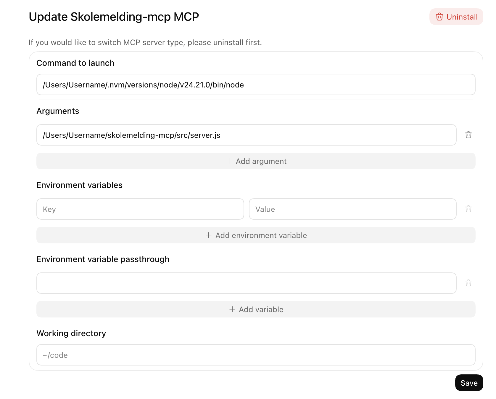

# Skolemelding MCP

Norsk · [English](README.md)

Les meldinger og vedlegg fra Skoleplattform Oslo med en lokal MCP-server. De fire verktøyene viser barna dine, viser meldinger, leser en melding og laster ned et vedlegg. De sender ikke svar og markerer ikke meldinger som lest.

Dette er en enkel lokal versjon som kjører på din egen datamaskin. `list_messages` viser maks 100 meldinger. Den kan søke etter ord i meldingene og vise bare uleste meldinger, meldinger med et ja/nei-spørsmål eller fraværsmeldinger; søk på datointervall finnes ikke ennå. Hvis du kjenner meldings-ID-en, kan `get_message` også finne eldre meldinger ved å bla gjennom opptil 1 500 innboksmeldinger. Koden har ingen fast datogrense, men hvor langt tilbake den når, avhenger av Skolemelding-tjenesten og hvor mange nyere meldinger du har.

Når skolen ber om et ja/nei-svar, har meldingen `question` med spørsmålsteksten. Når skolen ber foresatte bekrefte at de har lest meldingen, har den `readConfirmationRequested`. MCP-en kan ikke svare på noen av dem; bruk Skolemelding-appen til det.

Hver melding viser hvilke barn den gjelder. Har du flere barn i Osloskolen, viser `list_children` navnene deres, og `list_messages` tar imot `child` (fornavn eller fullt navn) for å vise bare meldingene til det barnet. Dette er bare testet på en konto med ett barn; se [sak #10](https://github.com/kristoffervp/skolemelding-mcp/issues/10) hvis du kan hjelpe til med å teste med flere.

Ved enkelte skoler i Osloskolen sendes ikke lenger meldingsinnhold og vedlegg på e-post. Denne MCP-en gjør det enklere å hente dem fra Skolemelding og bruke dem i en agentisk arbeidsflyt. Du er selv ansvarlig for å vurdere om skoleinformasjon skal deles med ChatGPT eller andre skybaserte eller kommersielle KI-tjenester.

## Eksempel: legg en skolehendelse i kalenderen

Et e-postvarsel med tittelen «Ny Skolemelding» sier at en ny skolemelding er tilgjengelig, men inneholder ikke selve meldingen. En assistent kan bruke denne MCP-en til å finne og lese meldingen, og laste ned eventuelle vedlegg med detaljer om hendelsen (med `include_content: true` hvis klienten ikke kan lese lokale filer).

En melding kan for eksempel si at det blir kartleggingsprøve i regning tirsdag morgen, og minne elevene på å spise frokost og møte presis. Assistenten kan da legge inn en heldagshendelse på tirsdag og ta med påminnelsene i beskrivelsen. Den bør ikke finne på et klokkeslett, og bør sjekke om hendelsen allerede finnes. Hvis økten i Skolemelding har utløpt, kan assistenten be brukeren fornye den med `npm run login` og prøve igjen etterpå.

## Installer

Installer Node.js 20 eller nyere og Google Chrome. Åpne prosjektmappen i Terminal og kjør:

```sh
npm install
npm run login
```

Fullfør innloggingen via ID-porten i Chrome. Kjør `npm test` for å kontrollere serveren uten å bruke kontoen din.

## Legg til i ChatGPT-appen (eksempel)

Åpne **Settings → MCP servers → Add server** og velg **STDIO**. Fyll inn:

| Felt | Verdi |
| --- | --- |
| Command to launch | Fullstendig sti til Node.js; finn den med `command -v node` |
| Arguments | Ett argument: fullstendig sti til prosjektets `src/server.js` |
| Working directory | Fullstendig sti til prosjektmappen |
| Environment variables | La stå tomt |

Lagre, start ChatGPT på nytt, og skriv `/mcp` i en samtale for å kontrollere tilkoblingen. Bytt ut eksempelstiene i skjermbildet med dine egne. `~/code` i bildet er bare en plassholder for arbeidsmappen.



Dette skjermbildet viser bare ett eksempel på oppsett. Serveren kan også brukes med [Claude Desktop](https://support.claude.com/en/articles/10949351-getting-started-with-local-mcp-servers-on-claude-desktop), [Grok Build](https://docs.x.ai/build/features/mcp-servers) eller en klient med en lokal KI-modell hvis klienten støtter lokale MCP-servere via stdio. Følg oppsettet for din klient; en modell alene kan ikke koble seg til MCP. ChatGPT i nettleseren bruker ikke dette lokale oppsettet.

## Vedlegg og innstillinger

`get_attachment` lagrer filen i `.data/attachments/` og returnerer sti, navn, filtype og størrelse. Selve filen er bare med i svaret fra verktøyet når det kalles med `include_content: true`; bilder returneres da som bilder og andre filer som innebygde ressurser. Klienter som ikke kan lese lokale filer, som ChatGPT-appen eller Claude Desktop, trenger `include_content: true` for å se hva et vedlegg inneholder. Klienter som kan lese lokale filer, kan åpne den lagrede filen uten.

Filer som ikke er vanlige dokumenter, bilder, lyd, video eller ZIP-arkiver, lagres med `.download` lagt til i navnet, slik at de ikke åpnes eller kjøres ved et uhell. På macOS og Windows merkes lagrede vedlegg også som lastet ned fra internett, slik at systemet advarer før de åpnes.

`get_message` returnerer meldingen og svarene som ren tekst; legg til `include_html: true` for også å få original-HTML. Meldinger gjenbrukes i opptil fem minutter, så `unread` kan henge etter hvis du leser en melding i appen.

Versjon 0.3.0 endret disse standardene. Tidligere versjoner returnerte alltid vedlegg som `base64` og meldinger med `bodyHtml`.

Du kan endre standardverdiene med disse miljøvariablene i innstillingene til MCP-klienten (og i Terminal for `npm run login`):

| Variabel | Standard | Formål |
| --- | --- | --- |
| `SKOLEMELDING_DATA_DIR` | `.data` i prosjektet | Innloggingsfil og lagrede vedlegg |
| `SKOLEMELDING_MOBILE_AUTH_FILE` | `mobile-auth.json` i datamappen | Lagret innlogging |
| `SKOLEMELDING_ATTACHMENT_DIR` | `attachments` i datamappen | Hvor `get_attachment` lagrer filer |
| `SKOLEMELDING_BROWSER_CHANNEL` | `chrome` (`msedge` på Windows) | Nettleser for innlogging |
| `SKOLEMELDING_PLAYWRIGHT_PATH` | `playwright` fra `node_modules` | Playwright-installasjonen som brukes |
| `SKOLEMELDING_APP_VERSION` | `6.0.6` | Appversjonen som sendes til Skolemelding |
| `SKOLEMELDING_OIDC_CLIENT_ID`, `SKOLEMELDING_TOKEN_CLIENT_ID` | Verdier fra den offisielle appen | Klient-ID-er for innlogging |

Innloggingen etterligner den offisielle appen Skolemelding Foresatte. Hvis Skolemelding begynner å avvise innlogging eller fornyelse etter en appoppdatering, sett `SKOLEMELDING_APP_VERSION` til versjonen som står i app-butikken nå, og kjør `npm run login` på nytt.

## Sikkerhet og personvern

Denne MCP-en kjører lokalt og åpner ingen nettverksport. En KI-klient du kobler til, kan likevel hente skolemeldinger og vedlegg fra kontoen din. Innhold som brukes i en KI-tjeneste i skyen, kan bli sendt til tjenesten. Meldinger kan også inneholde tekst som forsøker å påvirke agenten. MCP-en fjerner usynlige tegn og tekst som er skjult i meldingens HTML, og verktøybeskrivelsene ber klienten behandle meldingstekst som informasjon, ikke instruksjoner, men det kan ikke stoppe alle forsøk. Bruk klienter du stoler på, gjennomgå verktøykall, og del aldri innloggingsfilene i `.data/`. Lagrede vedlegg blir liggende i vedleggsmappen til du sletter dem.

Innloggingen registrerer denne datamaskinen som en enhet på Skolemelding-kontoen din, slik mobilappen gjør. Den sender navnet på operativsystemet og kjerneversjonen (for eksempel `darwin|25.6.0`), appversjonen og en tilfeldig enhets-ID som lages ved innlogging.

`npm run login` bruker en ny, tom nettleserprofil og sletter den når innloggingen er ferdig, så ingen ID-porten-økt eller lagret passord blir liggende igjen. Versjoner før 0.5.1 beholdt en nettleserprofil i `.data/mobile-browser-profile/`; den mappen kan du slette.

Løsningen bruker udokumenterte Skolemelding-endepunkter som kan endres. Hvis økten utløper, kjør `npm run login` på nytt.

## Endringslogg

### 0.5.1
- `npm run login` beholder ikke lenger en nettleserprofil; `SKOLEMELDING_MOBILE_PROFILE` er fjernet. En gammel `.data/mobile-browser-profile/`-mappe kan slettes.
- Usynlige tegn og skjult tekst fjernes fra meldingstekst, og verktøybeskrivelsene sier at meldingstekst er informasjon, ikke instruksjoner.
- Vedlegg av uvanlige filtyper lagres med `.download` lagt til, og lagrede vedlegg merkes som lastet ned på macOS og Windows.
- Meldinger har ikke lenger `recipients`.
- Bare ett søk gjennom innboksen kjører om gangen, og et søk stopper etter 90 sekunder. Feilmeldinger viser ikke lenger lokale filstier.

### 0.5.0
- `list_messages` tar imot `search`, `unread_only`, `questions_only` og `absence_only`. Søket og filtreringen gjøres av Skolemelding.
- Meldinger viser skolens ja/nei-spørsmål (`question`) og om skolen ber foresatte bekrefte at de har lest meldingen (`readConfirmationRequested`).

### 0.4.0 (2026-11-09)
- Nytt verktøy, `list_children`, og et `child`-filter i `list_messages`.
- Hver melding viser hvilke barn den gjelder.
- `recipients` utelates når feltet er tomt.

### 0.3.0 (2026-11-09)
- `get_attachment` lagrer filen lokalt og returnerer stien. Selve filen returneres bare med `include_content: true`.
- `get_message` returnerer ren tekst, også for svar. HTML returneres bare med `include_html: true`.
- Serveren håndterer flere forespørsler samtidig, og meldinger mellomlagres i fem minutter.
- Appversjon og klient-ID-er kan settes med miljøvariabler.
- Testene kjøres automatisk på GitHub ved hver endring.

### 0.2.0 (2026-10-06)
- Første offentlige versjon: `list_messages`, `get_message` og `get_attachment`.

## Lisens

Koden og dokumentasjonen har [0BSD-lisens](LICENSE): alle kan bruke, endre og dele dem gratis til alle formål, også kommersielt, uten krav om kreditering. Lisensen gjelder ikke Skolemelding-tjenesten eller innholdet der.

Ved publisering: bruk Git og kontroller `git status --short` før du lagrer endringene. `.gitignore` utelater lokale innlogginger, research-filer, installerte pakker og ZIP-arkiver. Ikke last opp hele mappen manuelt.
